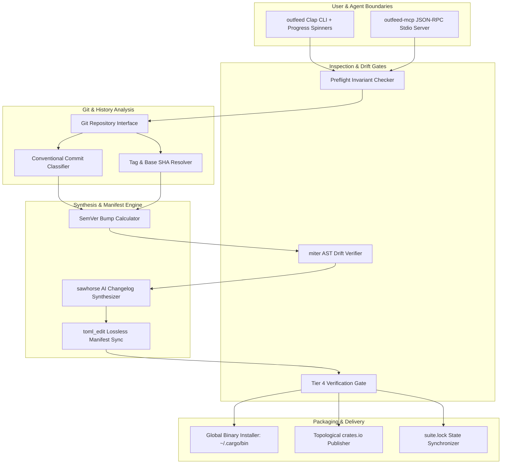
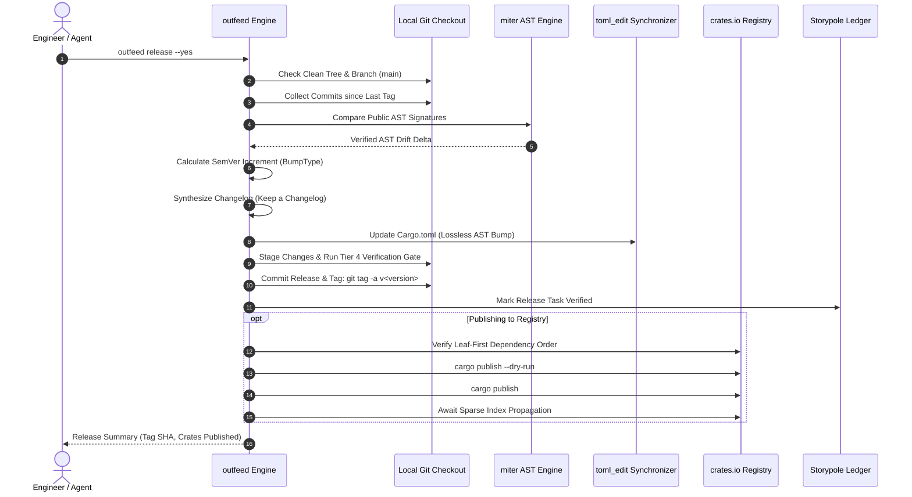

# `outfeed` — System Architecture

> **Domain:** Neurosymbolic Release Gate & Delivery Engine | **Suite:** `gaugeblock`

This document details the software architecture, subsystem components, dataflow, and registry publishing pipelines of `outfeed`.

---

## 1. System Decomposition

---

## 2. Release & Publication Sequence

---

## 3. Manifest Synchronization & Safety Architecture

* **Lossless AST Modification:** Built on `toml_edit`, parsing `Cargo.toml` into a concrete syntax tree where comments, spacing, and table order are preserved.
* **Topological Dependency Resolution:** Analyzes intra-workspace member dependencies to construct a Directed Acyclic Graph (DAG), ensuring crates with zero internal dependencies publish first, followed by intermediate crates, and finally top-level CLI entrypoints.
* **Network Fault Resilience:** Interrogates crates.io sparse index between publish steps to guarantee package availability before launching dependent crate publications, preventing registry build failures.

---

## 4. Crate & Package Topology

| Crate | Path | Responsibility |
|:---|:---|:---|
| [`outfeed`](./src/lib.rs) | `.` | Root facade re-exporting `outfeed_core` domain APIs |
| [`outfeed-core`](./crates/outfeed-core) | `crates/outfeed-core` | Core release engine, SemVer calculator, AST drift inspector, `toml_edit` sync |
| [`outfeed-cli`](./crates/outfeed-cli) | `crates/outfeed-cli` | Clap CLI binary, interactive terminal UI with `indicatif` progress spinners |
| [`outfeed-mcp`](./crates/outfeed-mcp) | `crates/outfeed-mcp` | Stdio Model Context Protocol (MCP) JSON-RPC 2.0 server |
