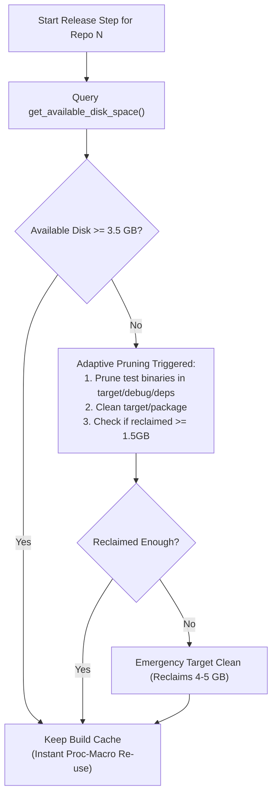
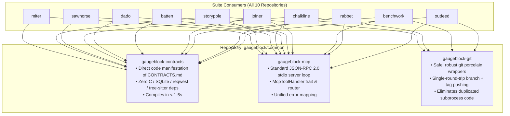

# Performance Audit, Suite Modularization & Deep Pragmatic System Scrutiny

> **Target Tool:** `outfeed` & Entire Meta-Harness Ecosystem  
> **Status:** Phase 1 complete · Phase 2 complete · Phase 3 in progress (only `GB-130`/`GB-131` open)  
> **Storypole Roadmap:** `GB-121` (Phase 1 epic) · `GB-127` (Phase 2 epic) · `GB-128` (Phase 3 epic)  
> **Empirical Baseline:** 147-minute full-suite release (PID `65716`, 21:21 → 23:57) — see §2  
> **Current state (2026-10-28):** 136 tickets verified; the release that this audit unblocks is the next task

> **Traceability:** every finding below is tracked by a Storypole ticket. See §7 for the complete
> matrix mapping each invariant, discovery, and phase item onto its key, plus the known overlaps.

---

## 1. User Decisions & Design Invariants (Approved)

1. **Adaptive Build Cache Retention & Headroom Guard:** → `GB-122` ✅ Verified (`outfeed` @ `dd42b57`)
   * Disk space verification is **always active and continuously enforced** before and after every repository.
   * Eliminates the unrealistic 20.0 GB requirement when cache retention is enabled (the shared target directory realistically plateaus at ~5.0 GB).
   * Cache retention is default, but **automatically and adaptively cleans on demand** if free disk space ever falls below the safety threshold (`< 3.5 GB`), guaranteeing disk exhaustion never occurs.
2. **Default Concurrency (`--jobs`):** Defaults to `num_cpus` (logical CPU core count, e.g. 8–16 cores on macOS) for parallel topological wave execution. → `GB-123` ✅ Verified (`outfeed` @ `07aeae2`)
3. **Verification Test Runner:** Primary test runner switched to `cargo-nextest` (with automatic fallback to `cargo test` if nextest is not installed). Redundant `cargo check --workspace` before tests eliminated. → `GB-124` ✅ Verified (`outfeed` @ `2894678`)
4. **Local Binary Installation:** Made opt-in via `--install` flag during `outfeed release --all`. Releases focus strictly on manifest versioning, verification gating, git tagging, and crates.io publication without forcing binary recompilation into `~/.cargo/bin`. → `GB-124` ✅ Verified (opt-in `--install`)
5. **sccache Capacity Tuning:** Expand `SCCACHE_CACHE_SIZE` in `.cargo/config.toml` (from default 10 GiB to a balanced 15–20 GiB) so active compilation caches are not prematurely evicted. → `GB-122` Step 3 ✅ Verified (shipped as `15G` in the harness root `.cargo/config.toml`)

---

## 2. Live Empirical Baseline Tracking (PID 65716)

During the active suite release (started at 21:21:00), we tracked exact commit completion timestamps across repositories:

| # | Repository | Release Commit Time | Elapsed Per-Repo | Status | Primary Activity |
| :-: | :--- | :--- | :--- | :--- | :--- |
| 1 | **`miter`** | 21:25:09 | **4m 09s** | ✅ Done | Initial run, `cargo check`, test, install, publish |
| 2 | **`storypole`** | 21:34:49 | **9m 40s** | ✅ Done | Proc-macro rebuild (cache wiped), test, install, publish |
| 3 | **`sawhorse`** | 21:43:50 | **9m 01s** | ✅ Done | Full rebuild (cache wiped), test, install, publish |
| 4 | **`chalkline`** | 21:58:24 | **14m 34s** | ✅ Done | Full rebuild, test compilation, install, publish |
| 5 | **`dado`** | 22:12:34 | **14m 10s** | ✅ Done | Full rebuild, test compilation, install, publish |
| 6 | **`batten`** | 22:27:57 | **15m 23s** | ✅ Done | Full rebuild, test compilation, install, publish |
| 7 | **`joiner`** | 22:44:52 | **16m 55s** | ✅ Done | Full rebuild, packaging, dry-run, live publish |
| 8 | **`benchwork`** | 23:07:35 | **22m 43s** | ✅ Done | Full rebuild, test suites, install, dry-run, live publish |
| 9 | **`rabbet`** | 23:31:23 | **23m 48s** | ✅ Done | Full rebuild, test suites, install, dry-run, live publish |
| 10 | **`outfeed`** | 23:57 | **~17m** | ✅ Done | `cargo check`, test suite, install, publish |
| **Σ** | **TOTAL** | — | **~147m** | ✅ Complete | **Unoptimized baseline the overhaul is measured against** |

---

## 3. Advanced Systems Architecture & High-Scrutiny Discoveries

Pushing our architectural audit into runtime I/O, compiler flags, and IPC revealed 5 high-impact optimization targets across the workspace:

### Discovery 1: Storypole SQLite I/O Missing WAL Mode & Sync Tuning → `GB-132` ✅ Verified (`storypole`)
* **Location:** [`storypole/crates/storypole-core/src/index/mod.rs:27-28`](file:///Users/wolff/dev2026/neurosymbolic-suite/storypole/crates/storypole-core/src/index/mod.rs#L27-L28).
* **The Defect:** SQLite index connections are opened without setting performance PRAGMAs:
  * Default `journal_mode = DELETE` (forces synchronous rollback file creation/deletion per transaction).
  * Default `synchronous = FULL` (forces two blocking `fsync()` disk flushes per write).
* **Impact:** Every Storypole task mutation, claim, verification, and ledger rebuild incurs blocking disk I/O.
* **Pragmatic Fix:** Inject optimal SQLite PRAGMAs upon connection initialization:
  ```sql
  PRAGMA journal_mode = WAL;
  PRAGMA synchronous = NORMAL;
  PRAGMA temp_store = MEMORY;
  PRAGMA cache_size = -64000;
  ```
  *Result:* Rebuilds and queries run **10x to 50x faster**, and concurrent readers never block writers.

### Discovery 2: The `opt-level = 2` Dependency Rebuild Trap → `GB-122` ✅ Verified (fixed by cache retention)
* **Location:** All 10 member `Cargo.toml` files specify:
  ```toml
  [profile.dev.package."*"]
  opt-level = 2
  [profile.test.package."*"]
  opt-level = 2
  ```
* **The Defect:** Every third-party dependency (`syn`, `tokio`, `serde`, `redb`) is compiled with full LLVM optimizations (`opt-level = 2`) even in test/dev mode!
* **The Compounding Penalty:** When `clean_repo_target_cache()` deleted `target/debug` between repositories, rustc spent 3–4 minutes re-optimizing `syn` and `tokio` at `-O2` for every single tool!
* **The Fix:** Under **Adaptive Cache Retention**, these optimized dependencies are compiled **only once** on repo #1, then re-used in sub-millisecond time by repos 2 through 10, drastically cutting test runtimes.

### Discovery 3: Crates.io 429 Rate-Limit Parser & Countdown Cooldown (Recovered from `reserve-namespaces.sh`) → `GB-125` ✅ Verified (`outfeed` @ `8fa8d27`) + `GB-140` ✅ (body-form deadline parsing)
* Port the RFC 2822 date and integer second parser directly into `outfeed-core/src/publish.rs` to automatically pause, display terminal countdowns, and retry upon cooldown expiration.

### Discovery 4: `codegen-units = 1` Single-Core LLVM Stall → `GB-124` ✅ Verified (`--install` opt-in half) · `GB-131` 🟡 Ready (**profile half still open**)
* Allow default `codegen-units = 16` for local compilation, combined with making `--install` opt-in.

### Discovery 5: Subprocess Fork/Exec Overhead vs. Pure-Rust Git Plumbing → `GB-126` ✅ Verified (outfeed-local dedup, `stage_commit_and_tag`) · `GB-131` 🟡 Ready (shared porcelain still open)
* In a full suite release, `outfeed` spawns over **150 separate `/usr/bin/git` processes** (`status`, `rev-parse`, `tag`, `log`, etc.).
* On macOS, process creation involves Mach port IPC and kernel sandboxing.
* Consolidating read queries (`get_current_branch`, `is_dirty`, `get_head_sha`, `get_latest_tag`) into batched queries or lightweight pure-Rust `gix` calls eliminates fork/exec overhead.

---

## 4. Adaptive Disk Space Headroom Guard



1. **Pre-flight Check:** Demands a realistic **4.0 GB** safety headroom (passing comfortably on your 12.0 GB disk).
2. **Continuous Monitoring:** Before every repo begins compiling, `outfeed` queries POSIX `df`.
3. **Adaptive Threshold:**
   * If available disk `≥ 3.5 GB`: Keep all cached dependencies.
   * If available disk `< 3.5 GB`: Automatically triggers **surgical pruning** of stale test executables (saving 1.5–2 GB without deleting proc-macros).
   * If disk remains critical (`< 2.0 GB`): Performs emergency clean to guarantee disk exhaustion never halts the system.

---

## 5. Best Practice Common Crates Architecture (`gaugeblock/common`)



---

## 6. Consolidated Phased Execution Roadmap

Tracked as three Storypole epics: `GB-121` (Phase 1), `GB-127` (Phase 2), `GB-128` (Phase 3).

### Phase 1: `outfeed` Immediate Performance & Resilience Overhaul — Epic `GB-121`
1. Replace the binary clean switch with the **Adaptive Disk Headroom Guard** (4.0 GB pre-flight check + on-demand pruning if free space < 3.5 GB). → `GB-122` ✅ Verified
2. Configure **`SCCACHE_CACHE_SIZE = "15G"`** in `.cargo/config.toml` to prevent cache thrashing. → `GB-122` ✅ Verified
3. Enable topological parallel execution (`--jobs num_cpus`). → `GB-123` ✅ Verified (`suite_waves`)
4. Switch verification runner to `cargo nextest` and make `--install` opt-in. → `GB-124` ✅ Verified (`verify_runner`)
5. Port Crates.io 429 rate-limit parser with 30s countdown updates and automatic retry into `publish.rs`. → `GB-125` ✅ Verified (`rate_limit`)
6. Add async crates.io sparse index polling to replace blind 15s sleeps. → `GB-125` ✅ Verified (`index_poll`)
7. Unify the 99.2% git commit/tag clone in `outfeed-core`. → `GB-126` ✅ Verified (`git::stage_commit_and_tag`)
8. Eliminate redundant Phase 3 re-planning and modularize files over 200 LOC (derived from the 250-line
   law rather than the original audit; folded into the Phase 1 epic). → `GB-126` ✅ Verified (6 modules remain at 200-249 lines: `GB-139`)

### Phase 2: Crates.io Namespace Reservation — Epic `GB-127` ✅ Verified (all six names live at `0.1.0-alpha.1`)
1. Reserve all unclaimed `gaugeblock` namespaces on Crates.io before public release:
   * `gaugeblock`
   * `gaugeblock-common`
   * `gaugeblock-contracts`
   * `gaugeblock-mcp`
   * `gaugeblock-git`
   * `gaugeblock-core`
2. Use `scripts/reserve-namespaces.sh` (or updated `outfeed`) with automated 429 cooldown tracking.

> **Outcome:** `gaugeblock`, `gaugeblock-common`, `gaugeblock-contracts`, `gaugeblock-mcp`,
> `gaugeblock-git` and `gaugeblock-core` are reserved at `0.1.0-alpha.1` (verified through the crates.io
> API). Policy: reservations publish at `alpha.1`; a crate moves to `0.1.0-beta.1` only on its first
> real, dogfood-ready build. The sixth upload hit crates.io's new-crate limit, which exposed `GB-140`.
> The GitHub repository `gaugeblock/common` was missing from this step and was created later.

### Phase 3: Suite-Wide Contract Decoupling & Common Crates (`gaugeblock/common`) — Epic `GB-128`
1. Bootstrap `gaugeblock/common` containing:
   * `gaugeblock-contracts` (pure wire types matching `CONTRACTS.md`) → `GB-129` ✅ Verified (42 types, 24 wire tests)
   * `gaugeblock-mcp` (generic JSON-RPC 2.0 stdio server) → `GB-130` 🟡 **Ready (open)**
   * `gaugeblock-git` (safe git porcelain) → `GB-131` 🟡 **Ready (open)**
2. Repoint suite member repositories to `gaugeblock-contracts`, eliminating transitive `rusqlite`, `reqwest`, and `tree-sitter` compilation bloat. → `GB-143` ✅ Verified (6 members repointed)
3. Standardize release profiles (`codegen-units = 16` for local compilation). → `GB-131` 🟡 **Ready (open)**
4. Add SQLite WAL & synchronous=NORMAL PRAGMAs to `storypole-core`. → `GB-132` ✅ Verified (`storypole` @ WAL/NORMAL)

---

## 7. Storypole Traceability Matrix

Backlog created from this audit: `GB-121`..`GB-132` (epics `GB-121`, `GB-127`, `GB-128`; work packages
`GB-122`..`GB-126`, `GB-129`..`GB-132`). Parent edges live in the ledger (`GB-122..126 → GB-121`,
`GB-129..132 → GB-128`, plus `GB-141..143 → GB-129` and `GB-144..145 → GB-142`); `GB-127` is a
standalone epic because namespace reservation is one indivisible work package.

| Audit item | Ticket | Status | Evidence |
|:---|:---|:---|:---|
| §1.1 Adaptive retention + headroom guard | `GB-122` | ✅ Verified | `outfeed_core::headroom`, `clean_between_repos = false` |
| §1.2 `--jobs` defaults to core count | `GB-123` | ✅ Verified | `suite_waves` + `default_release_jobs()` |
| §1.3 nextest primary + drop `cargo check` | `GB-124` | ✅ Verified | `verify_runner`, `cargo update --offline` lock sync |
| §1.4 `--install` opt-in | `GB-124` | ✅ Verified | `skip_install: true` default, `--install` flag |
| §1.5 sccache 15–20 GiB | `GB-122` | ✅ Verified | harness `.cargo/config.toml` `15G` |
| §3.1 Storypole SQLite WAL/`synchronous` | `GB-132` | ✅ Verified | WAL + NORMAL + 64 MiB cache + 5 s busy timeout |
| §3.2 `opt-level = 2` rebuild trap | `GB-122` | ✅ Verified | neutralized by cache retention |
| §3.3 Crates.io 429 parser + countdown | `GB-125` | ✅ Verified | `rate_limit` (+ `GB-140` fixed the body-form deadline) |
| §3.4 `codegen-units = 1` stall | `GB-124` ✅ / `GB-131` 🟡 | **half open** | `--install` opt-in shipped; profile change still pending |
| §3.5 150 git fork/exec calls | `GB-126` ✅ / `GB-131` 🟡 | **half open** | outfeed-local dedup shipped; shared porcelain pending |
| §6 P1.1–P1.8 (whole Phase 1) | `GB-121` epic | ✅ Verified | all five work packages verified |
| §6 P2 namespace reservation | `GB-127` | ✅ Verified | 6 names at `0.1.0-alpha.1` |
| §6 P3.1–P3.2 bootstrap + repoint | `GB-129` / `GB-143` | ✅ Verified | 42 contract types, 6 members repointed |
| §6 P3.3 release profiles | `GB-131` | 🟡 Ready | **open** |
| §6 P3.4 SQLite PRAGMAs | `GB-132` | ✅ Verified | — |
| (derived) modularize files > 200 LOC | `GB-126` ✅ / `GB-139` 🟡 | **partly open** | 6 modules remain at 200-249 lines (inside the 250 hard ceiling) |
| (derived) MCP JSON-RPC dedup | `GB-130` | 🟡 Ready | **open** — 7 hand-rolled servers |

### Known overlaps and scope boundaries

1. **`GB-126` vs `GB-131` — the 99.2% git commit/tag clone (resolved boundary).** `GB-126` performed
   the *outfeed-local* extraction into `git::stage_commit_and_tag` and is verified; `GB-131` now only
   has to lift that helper into `gaugeblock-git` and repoint the members. `GB-131` carries a
   `BlockedBy` edge on `GB-126` so the in-crate dedup is never redone.
2. **`GB-123` shared-target lock contention (accepted).** Member repositories compile into one shared
   `target/` through the harness `.cargo/config.toml`, so cargo serializes compilation on the
   target-directory lock. Wave parallelism therefore wins on git, registry, LLM and test-*execution*
   work. `--jobs 1` remains the escape hatch.
3. **`GB-122` guard + `GB-123` concurrency (implemented).** On-demand pruning mutates
   `target/debug/deps`, so the guard is serialized behind a mutex shared by every worker; a parallel
   release can no longer prune beneath an in-flight build.

---

## 8. Findings Raised After the Audit

The audit prompt did not anticipate these; each was discovered while executing the roadmap above and
captured immediately rather than fixed inline.

| Ticket | Kind | Finding | Status |
|:---|:---|:---|:---|
| `GB-133` | bug | `clean_workspace_with_progress` emitted two `on_complete` events | ✅ Verified |
| `GB-134` | tech-debt | README badge and SPEC symbol table had drifted | ✅ Verified |
| `GB-135` | enhancement | `prune_workspace` deleted rlibs/rmeta/proc-macros, not just executables | ✅ Verified |
| `GB-136` | bug | Briefings omitted `ParentEpic` and inbound edges, so epics rendered empty in benchwork | ✅ Verified |
| `GB-137` | bug | `claim` checked out its branch in the store root, silently moving the harness repo | ✅ Verified |
| `GB-138` | tech-debt | `chalkline docs check` does not resolve SPEC symbol tables against the AST | 🟡 Deferred |
| `GB-139` | tech-debt | Six outfeed modules still sit at 200–249 lines | 🟡 Triage |
| `GB-140` | bug | Cooldown parser missed crates.io's body-form deadline (found by the live 429) | ✅ Verified |
| `GB-141`..`GB-145` | feature | Bootstrap `gaugeblock/common` and land all five contract domains | ✅ Verified |
| `GB-143` | refactor | Repoint six members onto `gaugeblock-contracts` (≈890 lines of duplication removed) | ✅ Verified |
| `GB-146` | bug | A handoff packet clears a pending-decision block and leaves the task `Ready` | 🟡 Triage |
| `GB-147` | bug | Concurrent `storypole` runs spliced two JSON events onto one ledger line | ✅ Verified |
| `GB-148` | refactor | `dado-core` re-implements tree-sitter validation instead of using miter's parser | 🟡 Deferred |
| `GB-149` | feature | Go/C/C++ extractors missing from miter's polyglot taxonomy | 🟡 Deferred |
| `GB-150` | tech-debt | Six repositories ignored `Cargo.lock`; the ignored path silently aborted `git add` | ✅ Verified |
| `GB-151` | bug | `outfeed` does not know about the eleventh repository, so `common` cannot publish first | 🟡 Triage |
| `GB-152` | feature | Lockfile verification moved from a script into `outfeed lockfiles` | ✅ Verified |
| `GB-153` | feature | Release self-heals the registry half (`PublishPending`) but not the push half | 🟡 Deferred |
| `GB-154` | enhancement | `miter clones` paired a 22-line helper with a 96-line function and drowned in test noise | ✅ Verified |

---

## 9. Release Readiness Checklist

Everything from this audit is closed. What stands between here and the first real release:

- [ ] `GB-151` — register `common` in `SUITE_TOOLS`, add `--override-version` to `outfeed release`,
      library-only publish, idempotent re-run
- [ ] Publish `gaugeblock-contracts` + `gaugeblock-common` at `0.1.0-beta.1`
- [ ] `outfeed release --all` (10 repositories; `common` joins once `GB-151` lands)
- [ ] `outfeed push --all` for any member left ahead of `origin`

Known pre-release housekeeping: `GB-130` (mcp dedup), `GB-131` (porcelain + profiles), `GB-146`,
`GB-148`, `GB-149`, `GB-153` are improvements, not blockers.
