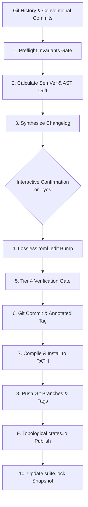

# `outfeed` — Neurosymbolic Release Gate, AST Drift Inspector & Delivery Orchestrator

[](https://gaugeblock.dev)
[](LICENSE)
[](https://github.com/gaugeblock)
[](ARCHITECTURE.md)

Part of the **[`gaugeblock`](https://gaugeblock.dev)** neurosymbolic code synthesis ecosystem.

> In carpentry, an **outfeed table** sits directly behind a table saw or planer to smoothly receive, support, and guide finished workpieces as they exit the blades, preventing tipping, kickback, and tear-out. In the `gaugeblock` meta-harness, `outfeed` is the packaging, release, and delivery engine: it ensures code exiting development meets rigorous verification gates, calculates deterministic SemVer increments, inspects public AST drift via `miter`, synthesizes architectural changelogs via `sawhorse`, updates manifests via `toml_edit`, and orchestrates suite-wide releases into `suite.lock`.

---

## 1. Why `outfeed`?

| Capability | Ad-Hoc Manual Releases | With `outfeed` |
|:---|:---|:---|
| **SemVer Calculation** | Guessing version bumps or forgetting breaking changes | **Deterministic Conventional Commit analysis** with AST drift floor verification |
| **Manifest Updates** | Regex find-replace that corrupts TOML comments and keys | **Lossless `toml_edit` AST manipulation** preserving all comments and formatting |
| **Changelog Generation** | Missing release notes or raw git log commit dumps | **Neurosymbolic changelog synthesis** authoring human-grade release notes |
| **Registry Publishing** | Failed crates.io publish due to dependency race conditions | **Topological leaf-first DAG publishing** with index propagation verification |
| **Ecosystem Sync** | Diverged git branches and mismatched suite versions | **Atomic `suite.lock` synchronization** aligning all 10 member repositories |
| **Agent Integration** | Fragile bash scripts wrapping git commands | **First-class Model Context Protocol (MCP) server** (`outfeed mcp`) |

---

## 2. Release & Delivery Pipeline



---

## 3. CLI Command Reference

The `outfeed` binary provides comprehensive release planning, manifest bumping, delivery, and workspace maintenance commands:

| Command | Key Flags / Options | Description |
|:---|:---|:---|
| `outfeed plan` | `--bump`, `--target-version`, `--no-llm`, `--json` | Evaluates commits, calculates SemVer bump, and previews changelog |
| `outfeed apply` | `--plan-id`, `--yes`, `--no-tag`, `--no-commit` | Bumps manifests, updates changelog, cuts Git tag, and completes release |
| `outfeed status` | `--all`, `--json` | Checks release status and unreleased commits across one or all repositories |
| `outfeed install` | `--all`, `--target`, `--force` | Compiles and installs CLI binaries into global `PATH` (`~/.cargo/bin`) |
| `outfeed push` | `--all`, `--remote`, `--dry-run` | Pushes branch updates and annotated release tags to Git remote |
| `outfeed publish` | `--all`, `--dry-run`, `--token` | Publishes member crates to crates.io in topological leaf-first order |
| `outfeed release` | `--all`, `--yes`, `--no-llm` | Executes full orchestrated release pipeline (plan $\to$ apply $\to$ install $\to$ push $\to$ publish) |
| `outfeed clone` | `--all`, `--protocol`, `--locked`, `--install` | Clones suite member repositories with optional `suite.lock` alignment |
| `outfeed sync` | `--all`, `--locked`, `--pull`, `--push` | Audits and synchronizes local repositories with upstream remotes or `suite.lock` |
| `outfeed clean` | `--all`, `--dry-run` | Cleans target compilation artifacts while preserving release binaries |
| `outfeed prune` | `--all`, `--dry-run` | Prunes stale test binaries and old build artifacts to reclaim disk space |
| `outfeed mcp` | *(none)* | Launches stdio JSON-RPC 2.0 Model Context Protocol server |

---

## 4. Model Context Protocol (MCP) Reference

When running as an MCP server (`outfeed mcp`), `outfeed` exposes structured tools for autonomous agents:

| Tool Name | Parameters | Description |
|:---|:---|:---|
| `outfeed_plan` | `repo_dir`, `target_version` | Compute next SemVer increment, inspect AST drift, and draft changelog preview |
| `outfeed_apply` | `plan_id`, `create_commit`, `create_tag` | Execute manifest updates, commit release changes, and create annotated Git tag |

---

## 5. Crate & Package Topology

| Crate | Path | Responsibility |
|:---|:---|:---|
| [`outfeed`](./src/lib.rs) | `.` | Root facade re-exporting `outfeed_core` domain APIs |
| [`outfeed-core`](./crates/outfeed-core) | `crates/outfeed-core` | Release engine, SemVer calculator, AST drift inspector, `toml_edit` sync |
| [`outfeed-cli`](./crates/outfeed-cli) | `crates/outfeed-cli` | Clap CLI binary, interactive terminal UI with `indicatif` progress spinners |
| [`outfeed-mcp`](./crates/outfeed-mcp) | `crates/outfeed-mcp` | Stdio Model Context Protocol (MCP) JSON-RPC 2.0 server |

---

## 6. Quickstart

```bash
# 1. Install outfeed CLI globally
cargo install --path crates/outfeed-cli

# 2. Plan a release for the current repository
outfeed plan

# 3. Apply the planned release (bump manifest, author changelog, cut tag)
outfeed apply --yes

# 4. Install updated binaries into ~/.cargo/bin
outfeed install --all

# 5. Push release branch and tags to remote
outfeed push --all

# 6. Audit suite alignment against suite.lock
outfeed sync --all --locked
```

---

## 7. Repository Documentation

`outfeed` adheres strictly to the canonical **9-Document Architecture**:
* **[`README.md`](./README.md):** Project overview, outfeed table metaphor, CLI reference, and delivery pipeline.
* **[`SPEC.md`](./SPEC.md):** Formal wire contracts, boundary types, release invariants, and state machines.
* **[`ARCHITECTURE.md`](./ARCHITECTURE.md):** Subsystem decomposition, topological DAG packager, and changelog synthesizer.
* **[`DESIGN.md`](./DESIGN.md):** Concrete Architectural Decision Records (ADRs).
* **[`PRODUCT.md`](./PRODUCT.md):** Personas, user journeys, JTBD, and release automation strategy.
* **[`CONTRIBUTING.md`](./CONTRIBUTING.md):** Rust 2024 toolchain requirements and tiered verification gates.
* **[`ROADMAP.md`](./ROADMAP.md):** Active milestones and upcoming release orchestration capabilities.
* **[`CHANGELOG.md`](./CHANGELOG.md):** Historical version releases and pending changes.
* **[`AGENTS.md`](./AGENTS.md):** Non-negotiable engineering laws and autonomous execution directives.

---

## 8. License

Licensed under the Apache License, Version 2.0 ([`LICENSE`](./LICENSE)).
