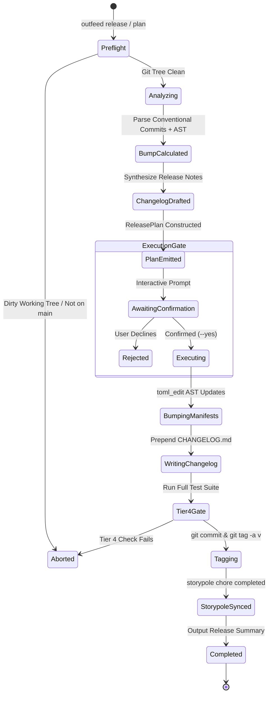
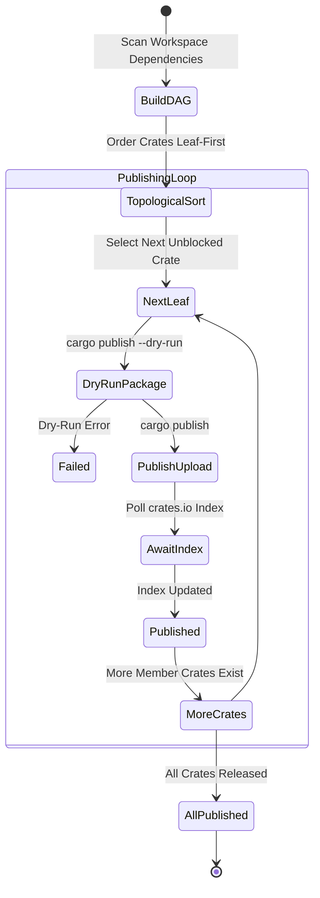

# `outfeed` — Behavioral Specifications & Invariants

> **Status:** Active Standard | **Domain:** Neurosymbolic Release Gate & Delivery Engine | **Suite:** `gaugeblock`

This specification defines the formal wire contracts, behavioral invariants, SemVer calculation rules, and topological publishing state machines for `outfeed`.

---

## 1. Behavioral Invariants

### Invariant 1: 3-Phase Release Pipeline (Check $\to$ Plan $\to$ Apply)
Release execution MUST proceed through three strictly sequenced phases:
1. **Preflight Check:** Validates that the git repository is on a release branch (`main`), the working directory is clean (`git status --porcelain` is empty), and required toolchains are installed.
2. **Transparent Plan:** Analyzes unreleased commits and AST signatures to calculate the deterministic SemVer increment, draft release notes, and generate an in-memory `ReleasePlan` with a unique ID.
3. **Confirmed Execution:** The plan MUST NOT modify files or cut git tags without interactive confirmation or explicit programmatic `--yes` approval.

### Invariant 2: Topological Leaf-First Publishing DAG
When publishing multi-crate workspaces to crates.io (`outfeed publish`), crates MUST be published in strict topological order where dependencies are published and confirmed available in the crates.io sparse index before any dependent crate begins publishing. Publishing failures halt the sequence to prevent broken dependency releases.

### Invariant 3: Lossless Manifest Synchronization
All modifications to `Cargo.toml` and member crate manifests MUST use `toml_edit` AST manipulation. Outfeed is strictly forbidden from using regex find-replace or destructive serialization (`toml::to_string`) that strips developer comments, formatting, or custom whitespace.

### Invariant 4: AST Drift Floor Verification
Conventional commit signals (`fix`, `feat`) set a baseline SemVer increment, but public AST signature changes detected via `miter` enforce a hard floor: if breaking symbol signature changes (removals, signature alterations) are detected in public APIs, the bump is upgraded to `Minor` (during `0.x` beta) or `Major` (during `1.x+`), regardless of commit prefix.

### Invariant 5: Closed-Loop Storypole Chore Synchronization
Applying a release creates an atomic release event and task verification receipt in Storypole, transitioning pending milestone tickets into `Verified` status and recording the cut Git tag SHA.

---

## 2. Formal State Machines

### Single-Repository Release State Machine

### Topological Registry Publishing State Machine

---

## 3. Formal Type Contracts

The following 35 types define the complete public and boundary interface for `outfeed`:

| Type Name | Kind | Crate / Module | Description |
|:---|:---|:---|:---|
| **`ApplyArgs`** | `struct` | `outfeed_cli::args` | Arguments for `outfeed apply` release execution |
| **`BranchDivergence`** | `enum` | `outfeed_core::sync_model` | Git branch divergence status relative to upstream tracking remote |
| **`BumpType`** | `enum` | `outfeed_core::model` | SemVer bump classification (`Patch`, `Minor`, `Major`) |
| **`CleanArgs`** | `struct` | `outfeed_cli::args` | Arguments for `outfeed clean` workspace cleanup |
| **`CleanOpts`** | `struct` | `outfeed_core::model` | Options controlling workspace cache cleaning |
| **`CleanReport`** | `struct` | `outfeed_core::model` | Summary report returned after a clean or prune operation |
| **`Cli`** | `struct` | `outfeed_cli::args` | Top-level Clap command-line parser definition |
| **`CloneArgs`** | `struct` | `outfeed_cli::args` | Arguments for `outfeed clone` repository bootstrap |
| **`CloneOpts`** | `struct` | `outfeed_core::clone` | Execution options for suite clone commands |
| **`CloneStatus`** | `enum` | `outfeed_core::clone` | Status outcome of a repository clone operation |
| **`CloneSummary`** | `struct` | `outfeed_core::clone` | Summary result for a single repository clone operation |
| **`CommandOutput`** | `struct` | `outfeed_core::cmd` | Captured output from a child process execution |
| **`Commands`** | `enum` | `outfeed_cli::args` | Top-level CLI command router enum |
| **`CommitInfo`** | `struct` | `outfeed_core::model` | Parsed Git commit metadata (hash, subject, author, date) |
| **`ConventionalKind`** | `enum` | `outfeed_core::model` | Conventional commit category (`feat`, `fix`, `refactor`, `chore`, etc.) |
| **`DeliveryOpts`** | `struct` | `outfeed_core::model` | Configuration options for delivery operations |
| **`DiskUsage`** | `struct` | `outfeed_core::model` | Breakdown of disk usage across target directories |
| **`GitProtocol`** | `enum` | `outfeed_core::clone` | Git protocol used for cloning suite repositories (`Ssh`, `Https`) |
| **`InstallArgs`** | `struct` | `outfeed_cli::args` | Arguments for `outfeed install` binary compilation |
| **`InstallOpts`** | `struct` | `outfeed_core::model` | Options controlling CLI binary installation |
| **`InstallOutcome`** | `enum` | `outfeed_core::install` | Result outcome of installing a tool (`Installed`, `Skipped`, `Failed`) |
| **`McpArgs`** | `struct` | `outfeed_cli::args` | Arguments for launching the MCP server |
| **`OutfeedError`** | `enum` | `outfeed_core::error` | Strongly typed error enum for all release, git, and manifest operations |
| **`PlanArgs`** | `struct` | `outfeed_cli::args` | Arguments for `outfeed plan` release preview |
| **`PruneArgs`** | `struct` | `outfeed_cli::args` | Arguments for `outfeed prune` stale binary removal |
| **`PublishArgs`** | `struct` | `outfeed_cli::args` | Arguments for `outfeed publish` registry publication |
| **`PushArgs`** | `struct` | `outfeed_cli::args` | Arguments for `outfeed push` remote delivery |
| **`ReleaseArgs`** | `struct` | `outfeed_cli::args` | Arguments for full orchestrated `outfeed release` pipeline |
| **`ReleasePlan`** | `struct` | `outfeed_core::plans` | Complete computed release plan including target version and changelog |
| **`RepoStatus`** | `struct` | `outfeed_core::progress` | Summary status of a repository's unreleased commits and tags |
| **`RepoSyncStatus`** | `struct` | `outfeed_core::sync_model` | Alignment status between local checkout and remote/suite.lock |
| **`StatusArgs`** | `struct` | `outfeed_cli::args` | Arguments for `outfeed status` inspection |
| **`SuiteReleasePlan`** | `struct` | `outfeed_core::suite_plan` | Multi-repository orchestrated release plan across the full suite |
| **`SyncArgs`** | `struct` | `outfeed_cli::args` | Arguments for `outfeed sync` synchronization command |
| **`SyncOpts`** | `struct` | `outfeed_core::sync_model` | Configuration options controlling repo synchronization |
