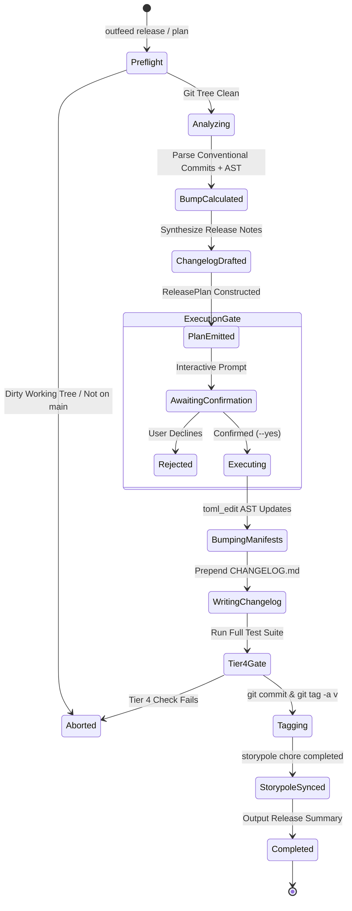
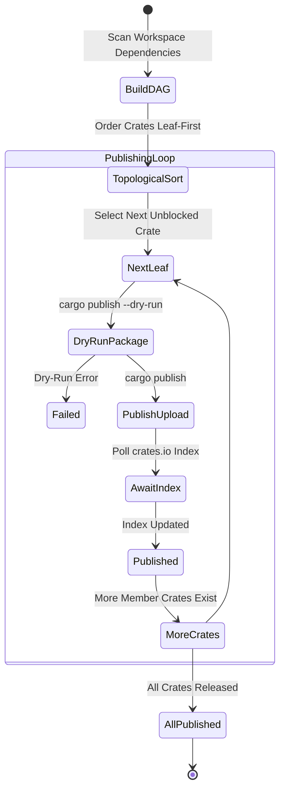

# `outfeed` — Behavioral Specifications & Invariants

> **Status:** Active Standard | **Domain:** Neurosymbolic Release Gate & Delivery Engine | **Suite:** `gaugeblock`

This specification defines the formal wire contracts, behavioral invariants, SemVer calculation rules, and topological publishing state machines for `outfeed`.

---

## 1. Behavioral Invariants

### Invariant 1: 3-Phase Release Pipeline (Check $\to$ Plan $\to$ Apply)
Release execution MUST proceed through three strictly sequenced phases:
1. **Preflight Check:** Validates that the git repository is on a release branch (`main`), the working directory is clean (`git status --porcelain` is empty), and required toolchains are installed.
2. **Transparent Plan:** Analyzes unreleased commits and AST signatures to calculate the deterministic SemVer increment, draft release notes, and generate an in-memory `ReleasePlan` with a unique ID.
3. **Confirmed Execution:** The plan MUST NOT modify files or cut git tags without interactive confirmation or explicit programmatic `--yes` approval.

### Invariant 2: Topological Leaf-First Publishing DAG
When publishing multi-crate workspaces to crates.io (`outfeed publish`), crates MUST be published in strict topological order where dependencies are published and confirmed available in the crates.io sparse index before any dependent crate begins publishing. Publishing failures halt the sequence to prevent broken dependency releases.

Rate limiting is never a failure: a `429` response resolves a cooldown from `Retry-After` (integer seconds or an RFC 2822 HTTP-date, defaulting to 30 s), reports a countdown through the progress reporter, and retries the same crate up to three times. Propagation waits poll `https://index.crates.io/<shard>/<name>` every 500 ms and proceed as soon as the new version appears; the configured delay is the poll timeout budget, not a fixed sleep.

### Invariant 3: Lossless Manifest Synchronization
All modifications to `Cargo.toml` and member crate manifests MUST use `toml_edit` AST manipulation. Outfeed is strictly forbidden from using regex find-replace or destructive serialization (`toml::to_string`) that strips developer comments, formatting, or custom whitespace.

### Invariant 4: AST Drift Floor Verification
Conventional commit signals (`fix`, `feat`) set a baseline SemVer increment, but public AST signature changes detected via `miter` enforce a hard floor: if breaking symbol signature changes (removals, signature alterations) are detected in public APIs, the bump is upgraded to `Minor` (during `0.x` beta) or `Major` (during `1.x+`), regardless of commit prefix.

### Invariant 5: Closed-Loop Storypole Chore Synchronization
Applying a release creates an atomic release event and task verification receipt in Storypole, transitioning pending milestone tickets into `Verified` status and recording the cut Git tag SHA.

### Invariant 6: Adaptive Disk Headroom with Cache Retention
Suite releases MUST retain the shared compilation cache between repositories and MUST NOT require an unrealistic static reservation for doing so:
1. **Cache retention is the default.** Inter-repository cleaning (`--clean-between-repos`) is opt-in, so optimised dependencies and proc-macros are compiled once and reused across all 10 repositories.
2. **Pre-flight demands 4.0 GB.** Because retention plateaus the shared `target` directory near 5.0 GB, every suite pre-flight uses `DEFAULT_MIN_SUITE_DISK_BYTES` regardless of the cleaning mode.
3. **Continuous enforcement.** Free space is measured before and after every repository release through `outfeed_core::headroom`.
4. **Tiered remediation.** `< 3.5 GB` free prunes extension-less test executables in `target/debug/deps` plus `target/package` staging while preserving rlibs, rmeta files and proc-macro libraries; `< 2.0 GB` free escalates to an emergency target cache clean so disk exhaustion can never halt a release.

### Invariant 7: Topological Wave Parallelism
Suite execution MUST respect the dependency order of the member repositories while exploiting the independence inside each layer:
1. **Leaf-first waves.** Repositories are released in five waves — `miter`; `storypole`/`sawhorse`/`dado`/`rabbet`; `chalkline`/`batten`; `joiner`; `benchwork`/`outfeed`. A repository may only run in a wave after every earlier wave has finished.
2. **Bounded concurrency.** At most `ReleaseOpts::jobs` entries run concurrently; the CLI resolves an unset `--jobs` to the logical CPU count, and `--jobs 1` retains strictly serial behaviour.
3. **Serialized shared resources.** The adaptive disk guard is mutex-guarded so it can never prune beneath an in-flight build, and the shared `target` directory remains arbitrated by the cargo lock.
4. **Deterministic reporting.** Worker results are collected in wave and plan order regardless of completion order, so progress output and summaries are reproducible.
5. **Failure containment.** A worker failure is surfaced as a typed error after sibling workers in the same wave are joined; no repository outside the failed wave is skipped silently.

### Invariant 8: Fast Verification Gate and Opt-In Installation
1. **Runner selection.** Tier 4 verification uses `cargo nextest run --workspace` when `cargo-nextest` is on `PATH`, followed by `cargo test --doc --workspace` because nextest skips doctests; otherwise it falls back to a single `cargo test --workspace`.
2. **No redundant compile.** `Cargo.lock` is synchronized with `cargo update --workspace --offline` (falling back to `cargo check --workspace` when the offline index is unavailable), so the harness never compiles the workspace twice before testing.
3. **Installation is opt-in.** `outfeed release` does not build release binaries unless `--install` is passed; a release ends at manifest updates, verification, tagging, pushing and registry publication.

---

## 2. Formal State Machines

### Single-Repository Release State Machine

### Topological Registry Publishing State Machine

---

## 3. Formal Type Contracts

The following 35 types define the complete public and boundary interface for `outfeed`:

| Type Name | Kind | Crate / Module | Description |
|:---|:---|:---|:---|
| **`ApplyArgs`** | `struct` | `outfeed_cli::args` | Arguments for `outfeed apply` release execution |
| **`BranchDivergence`** | `enum` | `outfeed_core::sync_model` | Git branch divergence status relative to upstream tracking remote |
| **`BumpType`** | `enum` | `outfeed_core::model` | SemVer bump classification (`Patch`, `Minor`, `Major`) |
| **`CleanArgs`** | `struct` | `outfeed_cli::args` | Arguments for `outfeed clean` workspace cleanup |
| **`CleanOpts`** | `struct` | `outfeed_core::model` | Options controlling workspace cache cleaning |
| **`CleanReport`** | `struct` | `outfeed_core::model` | Summary report returned after a clean or prune operation |
| **`Cli`** | `struct` | `outfeed_cli::args` | Top-level Clap command-line parser definition |
| **`CloneArgs`** | `struct` | `outfeed_cli::args` | Arguments for `outfeed clone` repository bootstrap |
| **`CloneOpts`** | `struct` | `outfeed_core::clone` | Execution options for suite clone commands |
| **`CloneStatus`** | `enum` | `outfeed_core::clone` | Status outcome of a repository clone operation |
| **`CloneSummary`** | `struct` | `outfeed_core::clone` | Summary result for a single repository clone operation |
| **`CommandOutput`** | `struct` | `outfeed_core::cmd` | Captured output from a child process execution |
| **`Commands`** | `enum` | `outfeed_cli::args` | Top-level CLI command router enum |
| **`CommitInfo`** | `struct` | `outfeed_core::model` | Parsed Git commit metadata (hash, subject, author, date) |
| **`ConventionalKind`** | `enum` | `outfeed_core::model` | Conventional commit category (`feat`, `fix`, `refactor`, `chore`, etc.) |
| **`DiskUsage`** | `struct` | `outfeed_core::model` | Breakdown of disk usage across target directories |
| **`GitProtocol`** | `enum` | `outfeed_core::clone` | Git protocol used for cloning suite repositories (`Ssh`, `Https`) |
| **`HeadroomAction`** | `enum` | `outfeed_core::headroom` | Remediation tier applied by the adaptive disk headroom guard (`Retained`, `Pruned`, `EmergencyClean`) |
| **`HeadroomStatus`** | `struct` | `outfeed_core::headroom` | Free-space measurement and reclaimed bytes from one adaptive headroom pass |
| **`InstallArgs`** | `struct` | `outfeed_cli::args` | Arguments for `outfeed install` binary compilation |
| **`InstallOpts`** | `struct` | `outfeed_core::model` | Options controlling CLI binary installation |
| **`InstallOutcome`** | `enum` | `outfeed_core::install` | Result outcome of installing a tool (`Installed`, `Skipped`, `Failed`) |
| **`McpArgs`** | `struct` | `outfeed_cli::args` | Arguments for launching the MCP server |
| **`OutfeedError`** | `enum` | `outfeed_core::error` | Strongly typed error enum for all release, git, and manifest operations |
| **`PlanArgs`** | `struct` | `outfeed_cli::args` | Arguments for `outfeed plan` release preview |
| **`PruneArgs`** | `struct` | `outfeed_cli::args` | Arguments for `outfeed prune` stale binary removal |
| **`PublishArgs`** | `struct` | `outfeed_cli::args` | Arguments for `outfeed publish` registry publication |
| **`PushArgs`** | `struct` | `outfeed_cli::args` | Arguments for `outfeed push` remote delivery |
| **`ReleaseArgs`** | `struct` | `outfeed_cli::args` | Arguments for full orchestrated `outfeed release` pipeline |
| **`ReleasePlan`** | `struct` | `outfeed_core::model::plans` | Complete computed release plan including target version and changelog |
| **`RepoStatus`** | `enum` | `outfeed_core::progress` | Outcome of a repository operation (`Success`, `Skipped`, `Failed`) |
| **`RepoSyncStatus`** | `struct` | `outfeed_core::sync_model` | Alignment status between local checkout and remote/suite.lock |
| **`StatusArgs`** | `struct` | `outfeed_cli::args` | Arguments for `outfeed status` inspection |
| **`SuiteReleasePlan`** | `struct` | `outfeed_core::suite_plan` | Multi-repository orchestrated release plan across the full suite |
| **`SyncArgs`** | `struct` | `outfeed_cli::args` | Arguments for `outfeed sync` synchronization command |
| **`SyncOpts`** | `struct` | `outfeed_core::sync_model` | Configuration options controlling repo synchronization |
| **`LockfileReport`** | `struct` | `outfeed_core::lockfiles` | Per-repository lockfile hygiene result: every member must track a fresh `Cargo.lock` |
| **`RepoLockfile`** | `struct` | `outfeed_core::lockfiles` | Tracked/fresh state of one repository’s lockfile, with an `ok`/`untracked`/`stale` status |
